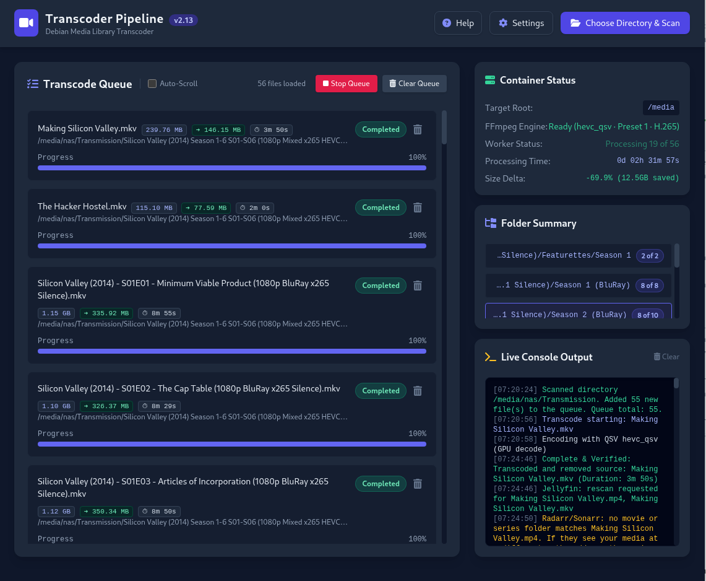
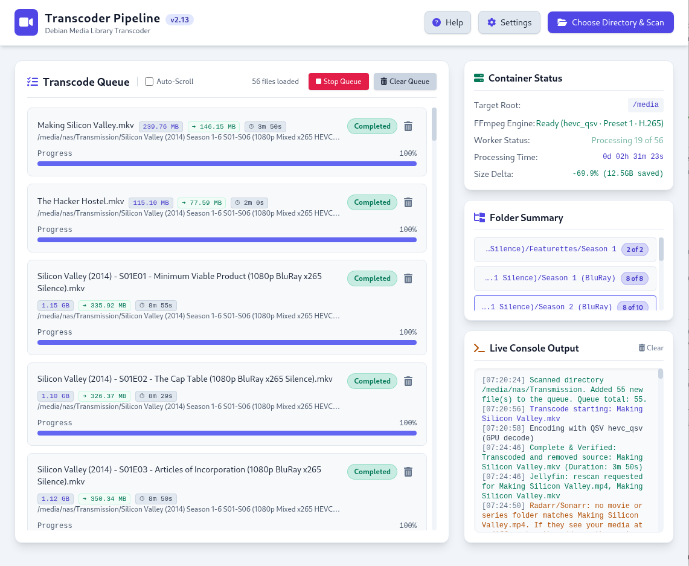

# Transcoder Pipeline for Home Assistant

A Home Assistant app (add-on) with a web dashboard that scans your media folders, transcodes video to MP4 with FFmpeg (Intel Quick Sync supported, with VAAPI and CPU fallbacks), and tells Jellyfin, Sonarr and Radarr about the changed files.

## Screenshots

The dashboard in the dark theme, and in the light theme (Settings can also make it follow Home Assistant's theme):

## Install

1. In Home Assistant go to **Settings > Apps > Install app** (older releases: **Add-ons > Add-on store**).
2. Open the three-dot menu, choose **Repositories** and add `https://github.com/tescophil/transcoder-pipeline` (or use the button above).
3. Find **Transcoder Pipeline** in the list, install it, and follow [the app documentation](transcoder_pipeline/DOCS.md).

## Features

- Opens inside Home Assistant (ingress), light/dark/follow-Home-Assistant theme, mobile layout
- Intel Quick Sync (QSV) with automatic fallback to VAAPI and software encoding
- Ten codec presets, MP4 compliance checks against your current settings
- Optional skip of MP4 files that would not shrink enough (estimated from sample clips)
- Jellyfin per-file rescans, Sonarr/Radarr webhook intake and rescans after transcoding
- Originals are only replaced after the new file has been verified with ffprobe

See [DOCS.md](transcoder_pipeline/DOCS.md) for setup and [CHANGELOG.md](transcoder_pipeline/CHANGELOG.md) for versions.

## Licence

MIT. See [LICENSE](LICENSE).
